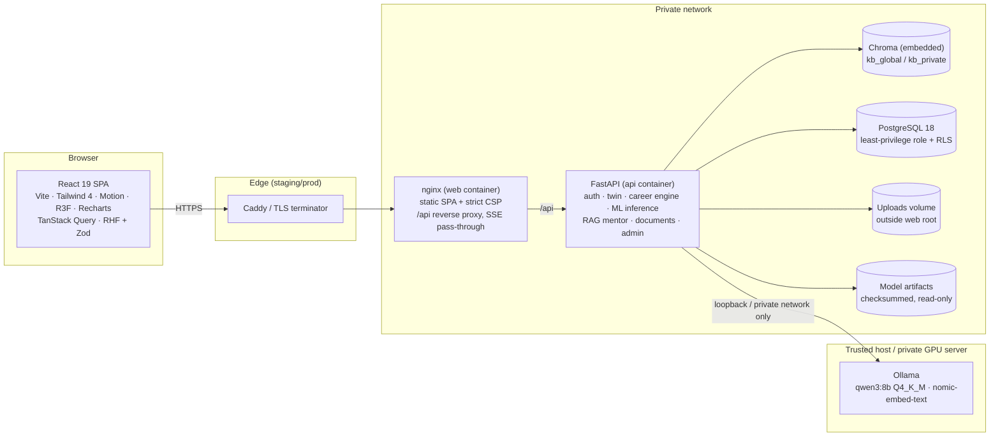

# Architecture



## Backend layering

```
app/
  api/v1/          HTTP layer: validation (Pydantic, extra=forbid), auth dependencies, response shapes
  services/
    auth_service   sessions, MFA, recovery              audit       append-only audit trail
    twin/          state (pure snapshot) → proficiency → features → history/snapshots/completeness
    career/        gap_engine · readiness · simulator · knowledge_graph · roadmap
    rag/           ollama_client · text (chunk/redact/injection) · store (Chroma) · knowledge_base · mentor · benchmark
    documents/     extract (sandboxed parsing) · parse (resume/JD analysis)
    privacy        consents · export · deletion · retention
  ml/              feature_schema (single contract) · registry (verified loading) · explain (SHAP)
  models/          SQLAlchemy 2 models (35 tables)        db.py  engine, sessions, RLS scoping
ml_pipeline/       datasets · synthetic · train · evaluation · report
eval/              RAG evaluation set + runner
```

**The key design decision** is that `TwinState` is a plain snapshot, and everything downstream is a pure function
of it. The what-if simulator therefore runs *exactly* the same estimation, feature, validation, model and gap code
on a deep copy, and cannot corrupt the real profile.

## Authentication and authorisation

* Opaque server-side sessions, not JWTs. The session cookie is HttpOnly, SameSite=Lax and Secure (`__Host-` in
  production). Only SHA-256 digests of tokens are stored. Sessions have idle and absolute expiry and can be revoked.
* CSRF: a synchroniser token per session (double-submit cookie plus a header checked against the stored digest),
  a custom request header required on every unsafe `/api` call, and an Origin allow-list.
* Roles are student, mentor and admin, checked by dependencies. Mentor access to a student needs an admin link
  **and** live consent.
* **Row-level security:** each transaction sets `app.user_id` and `app.privileged` (transaction-local GUCs,
  re-applied after every `BEGIN`). Policies on 20 student-owned tables enforce ownership even if a query forgets
  its filter. Privileged scope is entered only after an authorisation check in code.

## Data model (35 tables, 2 migrations)

Identity: users, user_sessions, auth_tokens, consents, mentor_links, audit_events. Catalogue: skills,
skill_prerequisites, career_roles, role_skill_requirements, role_versions, learning_resources, resource_skills,
assessments, assessment_skills. Twin: student_profiles, student_role_preferences, student_skills, projects,
experiences, certifications, assessment_results, skill_evidence, twin_snapshots, readiness_labels. Intelligence:
model_versions, predictions, what_if_scenarios, roadmaps, roadmap_items, roadmap_events, documents,
mentor_conversations, mentor_messages, user_feedback.

Integrity is enforced in the database: foreign keys with explicit `ON DELETE`, check constraints (ranges, enums,
evidence-source consistency, https-only URLs), partial unique indexes (one active model per kind, one active
roadmap per student), and UUIDv7 primary keys.

## ML lifecycle

`train.py` produces an artifact directory (model, manifest and report with figures) → `register` writes
`model_versions` with the SHA-256 → admin activation re-verifies it → `registry.warm()` loads and verifies at
start-up → every prediction stores the model version and twin snapshot it used.

## Mentor (RAG) request path

1. Rate limit, then input limits.
2. Ollama status check; if unavailable, return 503 and generate nothing.
3. Assemble the context:
   * an authoritative student summary from the requester's own rows;
   * owner-scoped retrieval with injection-flagged passages excluded;
   * conversation history;
   * all within the 4K-context budget.
4. Concurrency gate (1 active request, bounded queue).
5. Stream from Ollama.
6. Sanitise links (catalogue URLs only) and flag numbers not present in the context.
7. Persist the message, then send the `done` event with the final text.

## Frontend

* Route-level code splitting. three.js and charts load only when their components render (first paint excludes
  them).
* A design-token system in Tailwind 4 `@theme`. Fonts are self-hosted via Fontsource (OFL).
* Accessibility:
  * Radix primitives for focus management and ARIA;
  * a skip link;
  * labelled controls;
  * a keyboard-operable 2D graph;
  * reduced-motion support;
  * a 2D alternative for every 3D scene;
  * axe checks in tests.
* Server state lives in TanStack Query, with invalidation after twin mutations. Nothing sensitive is stored in
  `localStorage`; the only stored preference is the 3D on/off setting.
