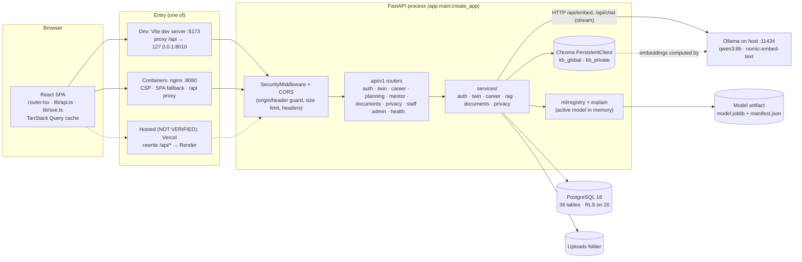
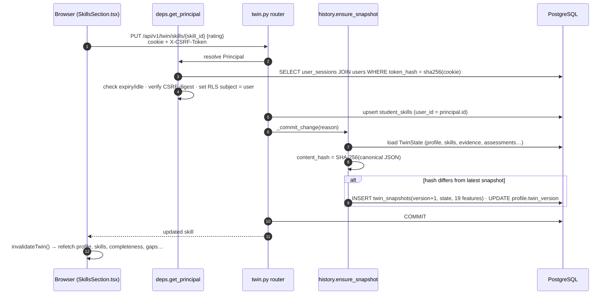
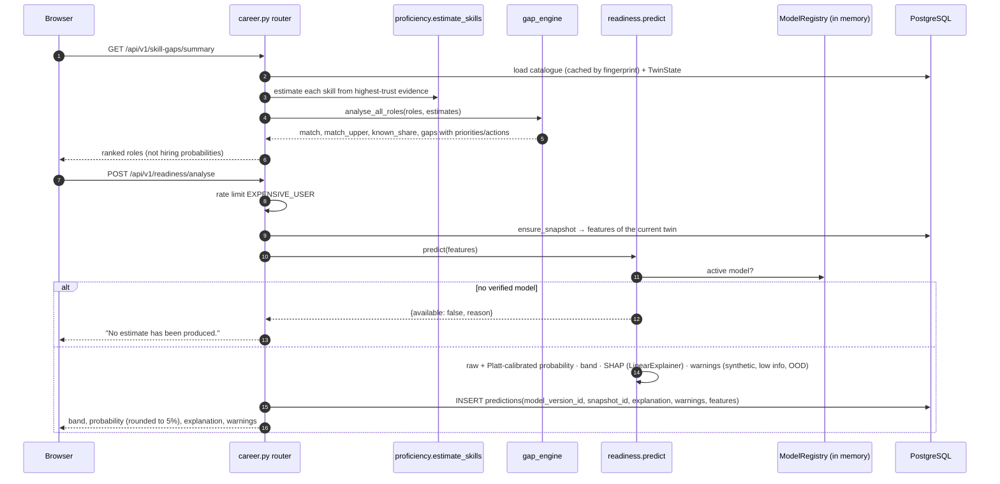
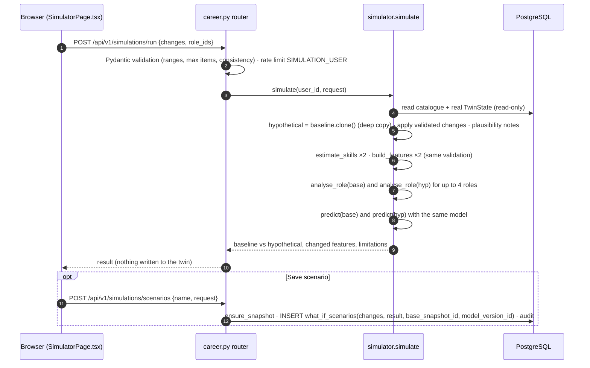
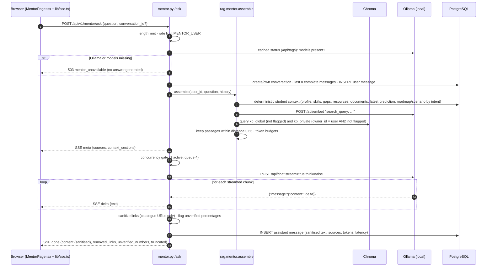
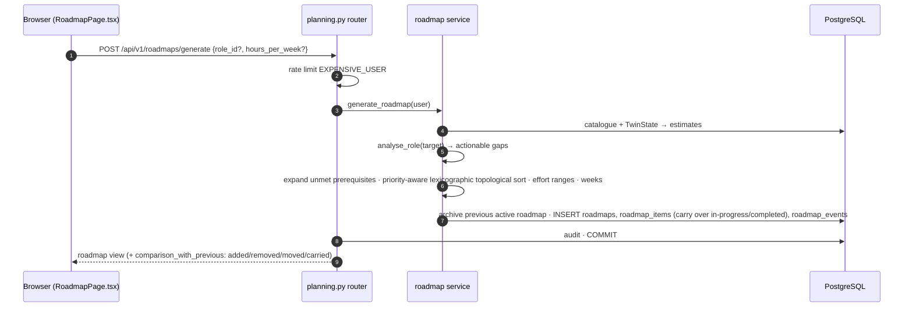
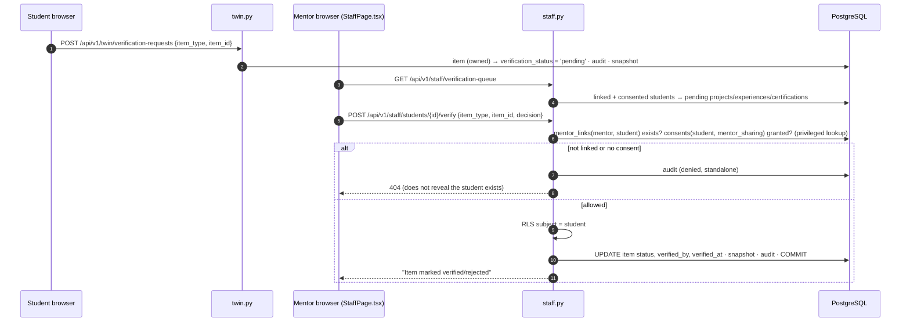

# 02 — System architecture

## 1. The big picture

The system is a **single-page web application** (React) talking to a **REST + streaming API** (FastAPI). The API owns
all business logic and talks to five back-end stores and services:

| Component | Technology | Role | Where it runs |
|---|---|---|---|
| Web client | React 19, TypeScript strict, Vite 8, Tailwind 4, TanStack Query, Radix, React Three Fiber, Recharts, Motion | UI, routing, data fetching/caching, 3D and 2D visualisations | Browser |
| Web server (container mode) | nginx (unprivileged) | Serves the built SPA with a strict CSP; reverse-proxies `/api` to the API; passes SSE through unbuffered | `web` container, `127.0.0.1:8080` |
| API | FastAPI on uvicorn, one worker | Auth, twin, career engine, ML inference, RAG mentor, documents, privacy, staff/admin | Native `127.0.0.1:8010` (dev) or `api` container port 8000 (internal only) |
| Relational database | PostgreSQL 18 | All structured data; row-level security | `db` container, loopback port 5433 |
| Vector store | Chroma `PersistentClient` (embedded in the API process) | Embedded knowledge-base and private-document chunks | Files under `DATA_DIR/chroma` |
| File store | Local disk | Uploaded documents (outside any web root) | `DATA_DIR/uploads` |
| Model artifacts | joblib + JSON manifest | Readiness model bundle, checksum-verified | `MODEL_ARTIFACT_DIR` |
| Local LLM runtime | Ollama with `qwen3:8b` (chat) and `nomic-embed-text` (embeddings) | Mentor generation and embeddings | Host machine, `127.0.0.1:11434` |

## 2. Architecture diagram



Dashed arrows mark the hosted path (Vercel → Render), which was verified only in a local simulation; on that host
the Ollama arrow does not exist, so the mentor reports itself unavailable
([12-docker-environment-and-deployment.md](12-docker-environment-and-deployment.md)).

## 3. Backend layering

```
HTTP request
  └─ SecurityMiddleware (backend/app/middleware.py)       request id · Origin + X-Requested-With guard · body limit · headers
     └─ CORSMiddleware (main.py L51–58)                   explicit origin allow-list, credentials
        └─ Router endpoint (backend/app/api/v1/*.py)      Pydantic validation (extra="forbid") · rate limits
           └─ Dependencies (backend/app/deps.py)          session cookie → Principal · CSRF check · RLS subject · role guard
              └─ Services (backend/app/services/**)       business logic; pure functions where possible
                 └─ db.py session                         every transaction sets app.user_id / app.privileged for RLS
                    └─ PostgreSQL (migrations 0001, 0002)
```

**Key design decision:** `TwinState` (`backend/app/services/twin/state.py` L86–124) is a plain-data snapshot of a
student. Proficiency estimation, features, gap analysis, readiness and the simulator are all functions of that
snapshot. That's why the simulator can reuse *exactly* the production pipeline on a deep copy
(`TwinState.clone()`, L99–100) without touching the database.

## 4. Who calls whom

| Caller | Callee | Sends | Receives | Stored where |
|---|---|---|---|---|
| Browser → API | JSON over HTTPS (or HTTP locally) with the session cookie; unsafe methods add `X-Requested-With: twinpath` and `X-CSRF-Token` | Request body (validated) | JSON envelope or SSE stream | Cookies in the browser; query cache in memory |
| API → PostgreSQL | psycopg 3 via SQLAlchemy 2 | SQL with bound parameters; `set_config` for RLS at each `BEGIN` | Rows | PostgreSQL volume |
| API → Chroma | In-process library calls | Embeddings + chunk text + metadata; queries with a `where` filter | Nearest chunks with cosine distances | `DATA_DIR/chroma` |
| API → Ollama `/api/embed` | `{"model": "nomic-embed-text", "input": [...], "truncate": true}` | Embedding vectors | Not stored by Ollama; stored in Chroma |
| API → Ollama `/api/chat` | System prompt + history + user block; `stream: true`, `think: false`, `num_ctx`, `temperature 0.3`, `num_predict 650` | Streamed JSON lines with text deltas and final token counts | Answer stored in `mentor_messages` |
| API → model registry | Feature vector (19 values; `None` = unknown) | Probabilities, SHAP values | Prediction stored in `predictions` |
| API → filesystem | Uploaded bytes under a random name | — | `DATA_DIR/uploads/<user_id>/…` |
| API → SMTP (optional) | Verification/reset e-mails | — | Not stored (development: `.eml` files in `DATA_DIR/outbox`) |

## 5. Sequence diagrams

All diagrams follow the code paths cited. Participants named *Svc* are Python modules, not separate services.

### 5.1 Student registration and authentication

Code: `backend/app/api/v1/auth.py` `register` L89–105, `login` L108–122; `backend/app/services/auth_service.py`
`register` L80–108, `login` L177–229, `create_session` L147–160.

```mermaid
sequenceDiagram
  autonumber
  participant B as Browser (AuthPages.tsx)
  participant M as SecurityMiddleware
  participant A as auth.py router
  participant S as auth_service
  participant DB as PostgreSQL
  participant E as Email (background task)

  B->>M: POST /api/v1/auth/register {email, password, display_name, consent}<br/>headers: X-Requested-With, Origin
  M->>M: reject if Origin not allowed or header missing (403)
  M->>A: forward
  A->>S: register(...)
  S->>S: rate limit REGISTER_IP · consent required · password policy
  S->>S: Argon2id hash (computed before lookup → equal timing)
  S->>DB: SELECT user by email
  alt new email
    S->>DB: INSERT users, consents(profile_processing), student_profiles, auth_tokens(verify_email digest), audit_events
  else existing email
    S->>DB: INSERT audit_events (failure, email_in_use)
  end
  S-->>A: outcome (never shown to client)
  A-->>B: 202 "If this address can be registered…" (identical either way)
  A--)E: send verification OR "account exists" e-mail after the response

  B->>A: POST /api/v1/auth/login {email, password}
  A->>S: login(...)
  S->>S: rate limits LOGIN_IP + LOGIN_ACCOUNT
  S->>DB: SELECT user FOR NO KEY UPDATE
  S->>S: locked? → generic 401 · verify Argon2id · count failures · exponential lockout
  alt MFA enabled
    S->>DB: INSERT auth_tokens(mfa_challenge digest)
    A-->>B: {status: "mfa_required", mfa_challenge}
  else
    S->>DB: INSERT user_sessions(token_hash, csrf_hash, expires_at) · audit
    A-->>B: Set-Cookie session (HttpOnly, SameSite=Lax) + csrf (readable, SameSite=Strict); body {me}
  end
```

### 5.2 Updating the digital twin

Code: `backend/app/api/v1/twin.py` `rate_skill` L214, `_commit_change` L97–99;
`backend/app/services/twin/history.py` `ensure_snapshot` L18–40; `backend/app/deps.py` `get_principal` L79–87.



### 5.3 Calculating role matches and readiness

Code: `backend/app/api/v1/career.py` `role_matches` L264, `run_readiness` L144–159;
`backend/app/services/career/gap_engine.py` `analyse_all_roles` L304–316;
`backend/app/services/career/readiness.py` `predict` L69–138, `store_prediction` L162–181.



### 5.4 Running a what-if simulation

Code: `backend/app/api/v1/career.py` `run_simulation` L303–306; `backend/app/services/career/simulator.py`
`simulate` L198–281, `apply_changes` L81–174.



### 5.5 Asking the Personalized Mentor

Code: `backend/app/api/v1/mentor.py` `ask` L158–292; `backend/app/services/rag/mentor.py` `assemble` L252–280,
`build_messages` L283–289, `sanitize_links` L217–239; `backend/app/services/rag/store.py` `retrieve` L118–159;
`backend/app/services/rag/ollama_client.py` `embed` L84–100, `chat_stream` L103–146.



### 5.6 Generating a roadmap

Code: `backend/app/api/v1/planning.py` `generate` L86–96; `backend/app/services/career/roadmap.py`
`generate_roadmap` L227–278, `plan_items` L95–220, `compare_roadmaps` L363–382.



### 5.7 Mentor verification of student evidence

Code: `backend/app/api/v1/twin.py` `request_verification` L499–510;
`backend/app/api/v1/staff.py` `_accessible_student` L44–57, `verify_item` L196–219, `verification_queue` L261–278.



The queue doesn't include pending **assessment results**, although `verify_item` accepts `assessment`. See
[15-project-progress-report.md](15-project-progress-report.md).

## 6. Data storage map

| Data | Store | Written by | Isolation |
|---|---|---|---|
| Accounts, sessions, tokens, consents, links, audit | PostgreSQL | auth, privacy, admin services | Code checks (no RLS on these tables) |
| Twin (profile, skills, evidence, assessments, snapshots, labels) | PostgreSQL | twin router, staff router | Code filters on `user_id` **and** RLS |
| Predictions, scenarios, roadmaps, conversations, feedback | PostgreSQL | career, planning, mentor, privacy routers | Code filters **and** RLS |
| Catalogue (skills, roles, resources, assessments) | PostgreSQL | seed, admin | Global reference data |
| Knowledge-base chunks | Chroma `kb_global` | `reindex_global`, admin upload | Readable by all signed-in users |
| Private document chunks | Chroma `kb_private` | document upload | `where owner_id = <session user>` applied before search |
| Uploaded files | Disk `DATA_DIR/uploads/<user_id>/` | documents router | Random names; access via owned document row |
| Readiness model | Disk + `model_versions` row | training pipeline, `deploy-init`, admin activation | SHA-256 verified before load |

## 7. Deployment topologies

| Mode | Front | API | Database | Ollama | Status |
|---|---|---|---|---|---|
| Native development | Vite dev server `localhost:5173` | uvicorn `127.0.0.1:8010` | Compose `db` on `localhost:5433` | Host `127.0.0.1:11434` | **Verified in this audit** (end-to-end 6/6) |
| Container pilot | nginx `127.0.0.1:8080` | `api` container (port 8000, internal network only) | Compose `db` | `host.docker.internal:11434` (compose `extra_hosts: host-gateway`) | **Verified in this audit** (end-to-end 6/6, health ok) |
| Free hosting | Vercel | Render free web service | Neon PostgreSQL 18 | Not available | **NOT VERIFIED** on the real services; local simulation only |
| Production behind TLS | Caddy (`infra/caddy/Caddyfile`) + nginx | `api` container | Managed PostgreSQL | Private GPU host | **NOT VERIFIED** |
