# 05 — Machine learning deep dive

> **Read this first.** The active readiness model was trained and evaluated **only on synthetic data** generated by
> the project's own simulator. Its metrics show how well it recovers that simulated process. They are **not**
> evidence about real students, and the estimate is **not** a hiring or placement probability.

All numbers in this chapter come from the bundled artifact
`backend/artifacts/bundled/readiness-202610141151-synth-logistic-d41952/manifest.json` (trained 2026-10-14, seed 42).
The model was not re-trained during this audit.

## A. The prediction problem

### What is predicted

`TARGET_NAME = "assessor_interview_ready"` (`backend/app/ml/feature_schema.py` L91–96): a binary label recorded by a
qualified assessor (mentor or faculty) after a structured review.

* **1** = judged ready to interview for an entry-level technical role.
* **0** = not yet.

It is deliberately **not** "got placed" or "got hired". Hiring outcomes depend on the job market, company quotas,
geography and luck, none of which are in the data. *Assessor-judged readiness* is a competency judgement a mentor can
actually make and record. The app records such labels through `POST /api/v1/staff/students/{id}/readiness-labels`
(`backend/app/api/v1/staff.py` L237–258), each frozen against the twin snapshot it was given for.

### What one training example is

One row = **one twin snapshot of one student at one semester**, plus that snapshot's label. A student can contribute
up to three rows (semesters 5–8). That's why splitting must keep a student's rows together (§C.2).

### The 19 input features

Defined once in `feature_schema.py` L39–86 and computed from a twin by `build_features`
(`backend/app/services/twin/features.py` L157–187).

| Feature | Range | How it's computed from the twin |
|---|---|---|
| `cgpa` | 0–10 | Profile CGPA |
| `semester` | 1–12 (integer) | Current semester |
| `lvl_programming`, `lvl_dsa`, `lvl_databases`, `lvl_web`, `lvl_ml_ai`, `lvl_data`, `lvl_cloud_devops`, `lvl_security` | 0–4 | Mean of the best available estimate for each **known** skill in that category (unknown skills excluded; all-unknown → missing) |
| `evidence_strength` | 0–1 | Share of known skills whose estimate comes from an assessment or verified evidence rather than weaker sources |
| `projects`, `deployed_projects` | 0–40 (integer) | Counts (clipped at 40) |
| `internship_months` | 0–60 | Months of internship/job experience (capped at 60) |
| `certifications_verified`, `hackathons` | 0–40 (integer) | Counts |
| `coding_assessment_pct`, `communication_pct`, `mock_interview_pct` | 0–100 | Latest **verified** result of that kind, as a percentage |

**Missing means unknown, not zero.** A missing value stays `None` → `NaN`. The pipeline imputes the median **and**
adds a *missing-indicator* column, so the model can learn that "not assessed" differs from "assessed low"
(`train.py` L67: `SimpleImputer(strategy="median", add_indicator=True)`).

`schema_hash()` (L99–101) hashes the feature definitions. The hash is stored in every model manifest and checked when
loading, so a model can never silently run against a different feature contract.

### How the synthetic data is generated

`backend/ml_pipeline/synthetic.py` (`GENERATOR_VERSION = "synthetic-cohort-v1"`). For each simulated student:

* Latent traits: aptitude *a*, diligence *d* and communication *k* are each drawn from N(0, 1). There is also a
  focus area (software / data / ml / web) and a specialization (CSE / IT / ECE / AI-DS).
* 1–3 snapshots in semesters 5–8, with progress *p* = (s − 5)/3.
* **Latent competency** *c* = 0.6*a* + 0.5*d* + 0.6*p* + N(0, 0.3²) (L58).
* Observed features are noisy, partly missing proxies of these latents:
  * category levels are inflated by self-rating when evidence strength is low (L68–70);
  * assessment scores are present only part of the time (L81–91).
* **Label:** *z* = 1.4*c* + 0.5*k* + 0.3·[has a deployed project] + N(0, 0.6²). Ready if *z* is above its 65th
  percentile (about 35% positives). Then **5% of labels are flipped** to mimic assessor inconsistency (L92–100).

Result: 1,500 students, 3,019 rows, a positive rate of 0.361, and about 2 snapshots per student
(manifest → `dataset.quality`).

### Why this can't be used as a hiring probability

1. The labels are simulated. They encode the generator's assumptions, not reality.
2. Even with real labels, the target is an assessor's judgement, not an employment outcome.
3. Associations aren't causes: SHAP and what-if changes describe what the *model* does.

The app enforces this framing: a `synthetic_model` warning on every prediction (`readiness.py` L84–93), the target
definition in every response, and the model card page.

### Data validation before training

`validate_and_clean` (`backend/ml_pipeline/datasets.py` L45–105):

* **Refuses** datasets containing personal or protected columns (`name`, `email`, `gender`, `religion`, `caste`,
  `dob`, `aadhaar`…; L52–58).
* Removes rows with invalid labels or out-of-range features, removes exact duplicates, and counts snapshots with
  conflicting labels.
* *Reports* (doesn't remove) 3×IQR outliers.

Real data sources are supported but gated:

* `csv:<path>` requires a provenance file with origin, permission, label definition, collection period and contact
  (L118–129).
* `app_labels` uses only labels of students who granted the `research_use` consent (L140–171).

## B. The algorithms

`candidates()` in `backend/ml_pipeline/train.py` L66–103 defines three pipelines. Each starts with the same imputer.

### B.1 Logistic regression (the selected model)

**Concept.** Take a weighted sum of the inputs and squash it into a probability:

$$z = b + w_1x_1 + w_2x_2 + \dots + w_nx_n = w\cdot x + b$$
$$p(y=1\mid x) = \sigma(z) = \frac{1}{1 + e^{-(w\cdot x + b)}}$$

* *x* = the input vector after imputation, missing indicators and standardisation (each feature becomes
  (value − mean)/std).
* *w* = one learned weight per input. A positive weight means a higher value raises the predicted probability.
* *b* = the intercept, the log-odds when all standardised inputs are 0 (i.e. at the training mean).
* *z* = the **log-odds**, ln(p/(1−p)). σ maps any real number into (0, 1).

**Interpretation.** Raising standardised input *j* by one unit adds *w_j* to the log-odds, i.e. multiplies the odds
by *e^{w_j}*, holding the others fixed.

**Loss actually optimised.** scikit-learn's `LogisticRegression` (default `lbfgs`, L2 penalty) minimises:

$$\tfrac12\lVert w\rVert^2 + C\sum_i \log\!\left(1 + e^{-y_i(w\cdot x_i + b)}\right),\quad y_i\in\{-1,+1\}$$

The second term is binary cross-entropy (log loss) written for ±1 labels; the first is L2 regularisation. **C** is
the inverse regularisation strength. The grid searched C ∈ {0.01, 0.1, 1, 10} and `class_weight` ∈ {None,
"balanced"}. The selected setting is **C = 0.01, class_weight = None**, i.e. strong regularisation that keeps the
weights small and stable.

**Pipeline in code:** `SimpleImputer(median, add_indicator) → StandardScaler → LogisticRegression(max_iter=2000)`
(`train.py` L69–78).

### B.2 Random forest

**Concept.**

* A *decision tree* splits the data with yes/no questions ("Is mock_interview_pct ≤ 62?") until the leaves are
  fairly pure.
* A *random forest* trains many trees, each on a **bootstrap sample** (rows drawn with replacement), considering
  only a **random subset of features** at each split.
* The forest's probability is the **average** of the trees' leaf probabilities.
* Averaging many decorrelated trees reduces variance (overfitting) compared with a single deep tree.

**Feature importance caveat:** impurity-based importance favours features with many distinct values. This project
reports SHAP and **permutation importance on the test set** instead.

**In code:** 300 trees; grid `max_depth` ∈ {4, 8, None}, `min_samples_leaf` ∈ {1, 5, 20} (L79–82). Best in CV:
depth 8, leaf 1 (PR-AUC 0.7589 ± 0.0157).

### B.3 XGBoost (gradient boosting)

**Concept.**

* Boosting builds trees **sequentially**. Each new tree is fitted to correct the current ensemble's errors.
* For log loss, every training row has a **gradient** (how the loss changes if the prediction moves) and a
  **Hessian** (how quickly that gradient changes). XGBoost uses both to choose splits and leaf values (a
  second-order approximation).
* A **learning rate** shrinks each tree's contribution; `min_child_weight`, `subsample` and `colsample_bytree` add
  regularisation.
* *Difference from a forest:* forest trees are independent and averaged (they reduce variance); boosted trees are
  dependent and additive (they mainly reduce bias).

**In code:** 300 rounds, subsample 0.8, colsample 0.8, `tree_method="hist"`; grid depth ∈ {2, 3, 4}, learning rate
∈ {0.03, 0.1}, `min_child_weight` ∈ {1, 5} (L83–101). Best in CV: depth 2, rate 0.03, min_child_weight 1 (PR-AUC
0.7586 ± 0.019).

### B.4 Baseline

`DummyClassifier(strategy="prior")` always predicts the base rate, giving CV PR-AUC **0.361**, which equals the
prevalence. All three models clearly beat it.

## C. The training pipeline (actual order in `train()`, `train.py` L283–500)

```mermaid
flowchart TD
  A["load_dataset (synthetic or provenance-checked)<br/>+ validate_and_clean"] --> B["grouped_split by student<br/>test 1/7 · validation 1/6 of rest · train"]
  B --> C["leakage_checks on train<br/>(shuffled-label CV, correlations)"]
  C --> D["baseline: DummyClassifier prior"]
  D --> E["tune each candidate: GridSearchCV<br/>5-fold StratifiedGroupKFold on TRAIN<br/>primary metric PR-AUC"]
  E --> F["select_model: best mean PR-AUC,<br/>then simplest within 1 SE (Occam)"]
  F --> G["refit chosen pipeline on TRAIN"]
  G --> H["Platt (sigmoid) calibration on VALIDATION<br/>(FrozenEstimator)"]
  H --> I["decision threshold = max F1 on VALIDATION"]
  I --> J["evaluate ONCE on TEST: ranking metrics,<br/>point metrics, bootstrap CIs, bands, semesters"]
  J --> K["SHAP background (100 train rows) ·<br/>global SHAP on 600 test rows · permutation importance"]
  K --> L["subgroup report by specialization ·<br/>training ranges p01/p99 for OOD"]
  L --> M["joblib bundle + SHA-256 · manifest.json · figures · report.md"]
  M --> N["register (model_versions) · activate (admin or deploy-init)"]
  N --> O["registry.warm() at API start → predict() at runtime"]
```



### C.1 Split (`grouped_split`, L106–115)

1. `StratifiedGroupKFold(n_splits=7)` takes one fold as **test**: about 1/7 of students, with the positive rate kept
   similar.
2. On the remainder, `StratifiedGroupKFold(n_splits=6)` takes one fold as **validation**.
3. An `assert` checks that **no student appears in two sets** (L113–114).

| Split | Rows | Students | Positive rate |
|---|---|---|---|
| Train | 2,155 | 1,058 | 0.361 |
| Validation | 432 | 221 | 0.361 |
| Test | 432 | 221 | 0.361 |

### C.2 Why grouped cross-validation matters

A student's semester-6 and semester-7 snapshots are nearly identical. With an ordinary random split, one could land
in training and the other in testing; the model would partly be "remembering the same student", and test scores
would be inflated. Grouping by `student_id` guarantees the model is always evaluated on **students it has never
seen**. The same grouping is used in every inner CV fold (`tune`, L173–201). Imputation and scaling sit *inside* the
pipeline, so they are re-fitted on each fold's training part only (no preprocessing leakage). Tested by
`test_grouped_split_has_no_student_leakage`.

**Leakage checks recorded in the manifest** (`leakage_checks`, L127–157):

* Training on **shuffled labels** gives CV ROC-AUC **0.5075**, i.e. chance level, so the pipeline can't find signal
  where none exists (sanity check passed).
* The largest absolute feature–label correlation is 0.455; no single feature gives the answer away.
* No identifier-like features; preprocessing fitted within folds; 0 students shared between splits.

### C.3 Model comparison and selection (`select_model`, L160–170)

| Candidate | Best hyperparameters | CV PR-AUC | CV ROC-AUC | CV Brier |
|---|---|---|---|---|
| **Logistic regression** | C = 0.01, class_weight = None | **0.7680 ± 0.0150** | 0.8459 | 0.1516 |
| Random forest | max_depth 8, min_samples_leaf 1 | 0.7589 ± 0.0157 | 0.8434 | 0.1543 |
| XGBoost | depth 2, lr 0.03, min_child_weight 1 | 0.7586 ± 0.0190 | 0.8412 | 0.1543 |
| Prior baseline | — | 0.361 | — | — |

The rule is to pick the highest mean CV PR-AUC, then the **simplest** candidate within one standard error (SE =
std/√5) of it. Logistic regression had the highest mean, so it was selected without needing the tie-break. That's
expected, because the generator's label is close to linear in the latents.

**Why PR-AUC is the primary metric:** with about 36% positives, precision–recall summarises how well the model finds
"ready" students without flooding the list with false positives. ROC-AUC can look good even when precision is poor.

### C.4 Calibration (implemented: Platt scaling)

*Calibration* means a predicted 0.7 should be right about 70% of the time.

* **Platt scaling** (implemented) fits a one-variable logistic regression on the validation set:
  p_cal = 1/(1 + e^{A·s + B}), where *s* is the model's uncalibrated decision score (log-odds).
  * Code: `CalibratedClassifierCV(FrozenEstimator(pipe), method="sigmoid").fit(X_va, y_va)` (L328–329).
  * `FrozenEstimator` keeps the trained model fixed, so only A and B are learned, on data the model never trained on.
* **Isotonic regression** is a non-parametric alternative. It is **not used** here.

**Validation rule** (L338): calibration counts as *validated* only if test ECE ≤ 0.05 **and** the calibrated Brier
isn't worse than the uncalibrated one by more than 0.002. If it isn't validated, the API shows **only a band, no
percentage** (`readiness.py` L94–100, L114–120).

| | Uncalibrated | Platt-calibrated |
|---|---|---|
| Test ECE | 0.0426 | 0.0455 |
| Test Brier | 0.1450 | 0.1457 |
| Validated? | — | **Yes** (both criteria met) |

**Honest observation:** on this data, Platt calibration did not *improve* calibration. Logistic regression is
usually well calibrated already, and the calibrated model is marginally worse but within tolerance. A future change
could keep the uncalibrated output when calibration doesn't help.

### C.5 Decision threshold and bands

* The **threshold** for the "ready" class is the one maximising F1 on the validation set: **0.4132**
  (`f1_threshold`, L204–207).
* The UI shows **bands** instead of yes/no (`ml_pipeline/evaluation.py` L22):

| Band | Probability range | Test rows | Observed "ready" rate on test |
|---|---|---|---|
| Not yet interview-ready | 0.00–0.35 | 239 (55%) | 12.6% |
| Developing | 0.35–0.65 | 115 (27%) | 51.3% |
| Likely interview-ready | 0.65–1.00 | 78 (18%) | 85.9% |

The observed rates rising across bands (12.6% → 51.3% → 85.9%) is what makes the bands meaningful.

### C.6 Evaluation metrics (synthetic held-out test set, 432 rows, 221 students)

| Metric | Meaning | Value | 95% CI |
|---|---|---|---|
| ROC-AUC | Probability a random "ready" row scores above a random "not ready" row | 0.861 | 0.823–0.895 |
| PR-AUC (average precision) | Area under precision–recall; baseline = prevalence 0.361 | 0.773 | 0.701–0.843 |
| Brier score | Mean squared error of probabilities (lower is better) | 0.146 | 0.129–0.164 |
| Log loss | Penalises confident wrong predictions | 0.450 | — |
| ECE (10 bins) | Average gap between predicted and observed rates, weighted by bin size (`expected_calibration_error`, `evaluation.py` L32–40) | 0.046 | 0.041–0.095 |
| Accuracy @ 0.413 | Share of correct decisions | 0.785 | — |
| Precision @ 0.413 | Of those predicted ready, share truly ready = TP/(TP+FP) | 0.698 | — |
| Recall @ 0.413 | Of the truly ready, share found = TP/(TP+FN) | 0.712 | — |
| F1 @ 0.413 | Harmonic mean of precision and recall | 0.705 | 0.640–0.764 |
| Specificity @ 0.413 | Of the not ready, share correctly identified | 0.826 | — |

Confusion matrix at 0.413: **TN 228, FP 48, FN 45, TP 111**. At the conventional 0.5 threshold, recall would drop to
0.590 (TP 92, FN 64), which is why the threshold is tuned on validation data.

**Confidence intervals** use a **student-clustered bootstrap** (`grouped_bootstrap_ci`, `evaluation.py` L87–110,
1,000 resamples). Whole students are resampled, not rows, because rows from the same student aren't independent.

**By semester (test):** ROC-AUC 0.840 / 0.888 / 0.846 / 0.856 for semesters 5 / 6 / 7 / 8.

**Subgroups by specialization (test, synthetic):**

| Group | n | Base rate | TPR | FPR | ROC-AUC | ECE |
|---|---|---|---|---|---|---|
| AI-DS | 91 | 0.319 | 0.828 | 0.226 | 0.862 | 0.112 |
| CSE | 176 | 0.369 | 0.646 | 0.171 | 0.845 | 0.055 |
| ECE | 52 | 0.288 | 0.667 | 0.108 | 0.845 | 0.162 |
| IT | 113 | 0.416 | 0.745 | 0.167 | 0.895 | 0.112 |

Largest gaps: TPR 0.181, FPR 0.118, ECE 0.106. These are **reported, not corrected**. No protected attributes are
collected or used. On synthetic data, these gaps show the reporting works; they say nothing about real fairness.

## D. SHAP and explainability

**Feature attribution** answers "how much did each input push *this* prediction up or down, relative to a reference?"
SHAP values come from cooperative game theory (Shapley values). For one prediction:

$$f(x) = \phi_0 + \sum_j \phi_j$$

* φ₀ (the *base value*) is the model's average output over a background sample.
* φ_j is feature *j*'s contribution: positive raises the output, negative lowers it.

**How it's implemented** (`backend/app/ml/explain.py`):

* For logistic regression, `shap.LinearExplainer(estimator, background)` (L31–34). Tree models would use an
  interventional `TreeExplainer`.
* The background is 100 randomly chosen **transformed training rows** (`train.py` L353–356).
* Explanations are computed on the **uncalibrated** pipeline in **log-odds** space, and the output space is reported
  with every explanation (L27–28, L116).
* Each feature's value column and its missing-indicator column are **summed back** into one contribution
  (`aggregate_to_features`, L51–59). An unknown input therefore shows up explicitly as, e.g., "Mock interview
  (unknown) lowers the estimate".
* **Additivity check:** `sum_check = base + Σ contributions` (L120). The test
  `test_shap_explanation_matches_model` verifies it equals the model's log-odds.
* A deterministic plain-language summary is built from the top attributions (`readiness.summarise`, L141–159). The
  LLM never writes or alters these numbers.

**Global vs local:**

* *Local* = one student's contributions (Readiness page chart).
* *Global* = mean |SHAP| over 600 test rows (model card). Top global features: CGPA (0.227), programming level
  (0.197), evidence strength (0.191), mock interview (0.176), data level (0.173), coding assessment (0.171).
* Permutation importance (drop in PR-AUC when a feature is shuffled on the test set) ranks mock interview (0.021),
  communication (0.018), data level (0.017), CGPA (0.016) and evidence strength (0.014) highest. The two methods
  measure different things, so their rankings differ.

**Importance is not causation.** A large positive SHAP value for "projects" means the *model* associates more projects
with readiness in its training data. It doesn't show that adding a project would make a real student readier, or
that projects caused anyone's outcome. In synthetic data the "causes" are, by construction, the latent traits that
the features merely proxy.

## E. Out-of-distribution (OOD) detection

**Implemented as univariate range checks** (`readiness._ood_warnings`, `backend/app/services/career/readiness.py`
L48–66):

* At training time, the 1st and 99th percentiles of every feature in the **training split** are stored in
  `training_ranges` (`train.py` L374–385). Example: evidence strength p01 = 0.104, p99 = 0.941; CGPA p01 = 4.40,
  p99 = 9.44.
* At prediction time, every **known** feature outside [p01, p99] produces a warning with code
  `out_of_distribution`, naming the feature, its value and the range.
* A separate `low_information` warning fires when fewer than 50% of the 19 inputs are known (L101–111).
* Warnings travel in the API response and are stored with the prediction. The Readiness page shows each as a
  `Notice`, and the mentor quotes up to three.

**Limits:** checks are per feature only. A *combination* of individually normal values that never occurred together
isn't detected (no multivariate method such as Mahalanobis distance or density estimation is implemented). A
brand-new student who has only self-rated skills has `evidence_strength = 0`, below p01, so they always receive an
OOD warning. That's correct (the synthetic cohort rarely has zero evidence), but it may surprise users.

## F. Model versioning and the registry

| Question | Answer (with code) |
|---|---|
| Where are artifacts stored? | A directory per version under `MODEL_ARTIFACT_DIR` (`backend/artifacts/models/` locally; the image ships `backend/artifacts/bundled/` copied to `/app/artifacts/models`) containing `model.joblib`, `manifest.json`, `report.md`, `figures/` |
| How is metadata associated? | `manifest.json` holds everything about the run. `register_artifact` (`backend/app/ml/artifacts.py`) copies the key fields (version, algorithm, target, metrics, dataset ref, schema hash, artifact path, **SHA-256**) into a `model_versions` row |
| How is a model activated? | `POST /api/v1/admin/models/{id}/activate` (`admin.py` L520–537) **first loads and verifies** the artifact, retires the previous active model, sets `status='active'`, audits and reloads the registry. A partial unique index `uq_model_versions_one_active` (one active per kind) enforces a single active model in the database. Hosted deployments use `deploy-init`, which activates the newest bundled artifact only if none is active |
| What does loading verify? | `ModelRegistry.load_artifact` (`registry.py` L72–102): path inside the artifact directory; file SHA-256 equals the registered value (joblib is pickle, so never load an unverified file); feature-schema hash equals the running code's; scikit-learn and XGBoost major.minor equal the training versions |
| How do predictions identify the model? | Every `predictions` row stores `model_version_id` (FK, `RESTRICT` on delete) and `snapshot_id`, plus the features and explanation used. Responses include `model_version` |
| No active model? | `registry.active()` is `None` → `predict()` returns `{"available": false, "reason_unavailable": …}` (`readiness.py` L70–72); the API answers "No estimate has been produced". **No fallback model is ever substituted.** Test: `test_readiness_unavailable_without_model` |
| Rollback? | Activate any previously registered version through the same endpoint; it is re-verified first |
| Historical inference? | Past predictions are stored, not recomputed. Re-scoring an old snapshot with an old model needs that artifact still on disk; there is no batch re-scoring feature |
| Tamper protection tested? | `test_registry_rejects_tampered_or_mismatched_artifacts`, `test_model_activation_refuses_tampered_artifact`, `test_deploy_init_registers_shipped_model_once` |

## G. Worked example (illustrative numbers only)

*These numbers are invented for teaching. They are not the model's real weights or outputs.*

A student has CGPA 8.0, programming level 2.5 and mock interview **unknown**; the other inputs are omitted for
brevity.

1. **Imputation.** Mock interview is missing → imputed with the training median (say 60) **and** its missing
   indicator is set to 1.
2. **Standardisation.** With training mean 7.0 and std 1.0, CGPA 8.0 → +1.0. With mean 2.0 and std 0.8, programming
   2.5 → +0.625. Mock interview 60 at the median → 0.0. The indicator 1 → say +1.3 after scaling.
3. **Linear score** with illustrative weights b = −0.6, w_cgpa = 0.4, w_prog = 0.5, w_mock = 0.6,
   w_mock_missing = −0.3:
   z = −0.6 + 0.4·1.0 + 0.5·0.625 + 0.6·0.0 + (−0.3)·1.3 = −0.6 + 0.4 + 0.3125 + 0 − 0.39 = **−0.2775**.
4. **Uncalibrated probability:** σ(−0.2775) = 1/(1 + e^{0.2775}) ≈ **0.431**.
5. **Platt calibration** with illustrative A = −0.95, B = 0.05: p_cal = 1/(1 + e^{(−0.95)(−0.2775) + 0.05}) =
   1/(1 + e^{0.3136}) ≈ **0.422**.
6. **Display.** Rounded to the nearest 5% → **40%**; the band is *Developing* (0.35–0.65).
7. **SHAP** (linear model): contribution φ_j = w_j·(x_j − mean of x_j over the background). Here CGPA ≈ +0.40,
   programming ≈ +0.31, and "mock interview (unknown)" ≈ −0.39, the value and indicator columns summed. The summary
   would read: "Factors that raised the model's estimate: CGPA (8.0/10), Programming level (2.5/4). Factors that
   lowered it: Mock interview (unknown)."

## H. Reproducibility and tests

* Training with the same seed and data gives the same result (`test_training_is_reproducible`).
* The synthetic generator is deterministic per seed (`test_synthetic_generator_is_deterministic`).
* Tests train a small model in quick mode (500 students, first grid value only) into a temporary folder, so they
  never depend on local files (`backend/tests/conftest.py` `trained_artifact` L100–106).
* `test_trained_artifact_manifest_is_complete_and_honest` checks that the manifest contains the synthetic warning,
  limitations, metrics, CIs, calibration and leakage checks.

**Command to retrain locally** (writes a new artifact and makes it active):

```bash
cd backend && uv run python -m ml_pipeline.train --source synthetic --seed 42 --activate
```
